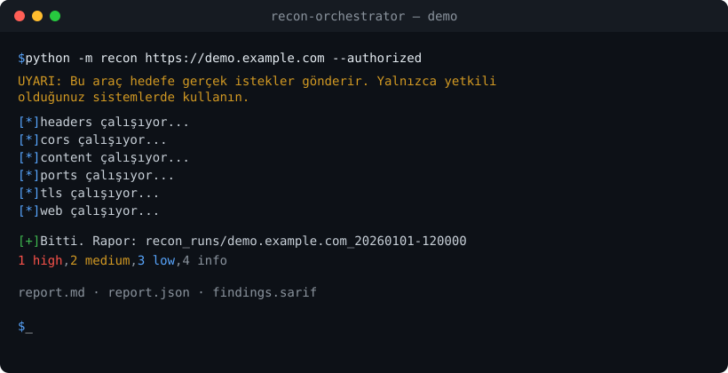

# recon-orchestrator

[](https://github.com/m0Corut/recon-orchestrator/actions/workflows/ci.yml)


Yetkili güvenlik testleri için hafif bir **araç orkestratörü**. Tek bir komutla
tanınmış açık kaynak güvenlik araçlarını (nmap, nuclei, testssl.sh) ve yerleşik
Python kontrollerini (güvenlik başlıkları, CORS, içerik keşfi) bir hedefe karşı
çalıştırır; sonuçları tek biçimde toplayıp **Markdown + JSON + SARIF** rapor üretir.

> Pahalı bir LLM'e bağımlılığı **yoktur**; tamamen ücretsiz araçlarla çalışır.
> İsteğe bağlı bir "analist" katmanı ileride eklenebilir.

## ⚠️ Yasal uyarı

Bu araç hedefe **gerçek istekler gönderir**. Yalnızca **sahibi olduğunuz** veya
**yazılı izniniz olan** sistemlerde kullanın. Yetkisiz tarama çoğu ülkede suçtur.
Sorumluluk tamamen size aittir. Araç, bunu onaylamanız için `--authorized`
bayrağını zorunlu kılar.

## Gereksinimler

- Python 3.9+
- `requests` (`pip install -r requirements.txt`)
- Docker — yalnızca `ports`, `tls`, `web` modülleri için (nmap/testssl/nuclei
  imajları ilk çalıştırmada otomatik çekilir). Docker yoksa bu modüller atlanır,
  Python tabanlı modüller (`headers`, `cors`, `content`) yine çalışır.

## Örnek çıktı



Her çalıştırma `recon_runs/<host>_<zaman>/` altına `report.md`, `report.json` ve
`findings.sarif` yazar. Rapor biçimi için bkz. [examples/sample-report.md](examples/sample-report.md).

## Kurulum

```bash
git clone <repo-url> && cd recon-orchestrator
pip install -r requirements.txt
# veya paket olarak:
pip install .
```

## Kullanım

```bash
# Tüm modüller (Docker gerektirenler dahil)
python -m recon https://ornek.com --authorized

# Sadece Docker'sız hızlı kontroller
python -m recon ornek.com -m headers,cors,content --authorized

# Rate limit düşür (production'da nazik ol), kendi wordlist'in
python -m recon https://ornek.com --authorized --rate 10 --wordlist paths.txt

# CI için: high+ bulgu varsa çıkış kodu 2
python -m recon https://ornek.com --authorized --fail-on high

# Rapor dili (varsayılan İngilizce; Türkçe için):
python -m recon https://ornek.com --authorized --lang tr

# Kapsam: varsayılan sadece hedef host; ek host'lara izin ver:
python -m recon https://ornek.com --authorized --scope "api.ornek.com,*.cdn.ornek.com"

# CI'da sadece YENİ bulguda patlat (önceki çalıştırma otomatik baz alınır):
python -m recon https://ornek.com --authorized --fail-on-new high

# Belirli bir baseline ile; ya da iki raporu doğrudan karşılaştır:
python -m recon https://ornek.com --authorized --baseline ./onceki/report.json
python -m recon diff ./onceki/report.json ./yeni/report.json

# YAML yapılandırma: örnek oluştur, düzenle, çalıştır:
python -m recon init                       # recon.yaml şablonu yazar
python -m recon --config recon.yaml --authorized
```

**Paralellik:** Modüller varsayılan olarak paralel çalışır (en uzun süreyi alan
nuclei/testssl/nmap artık örtüşür). `--jobs N` ile eşzamanlılık sınırlanır,
`--serial` ile sıraya alınır. Aktif HTTP modülleri ortak bir hız bütçesini
(`--rate`, toplam istek/sn) paylaşır, böylece paralellik hedefi yormaz.

**Yapılandırma dosyası:** `recon init` ile oluşturduğun `recon.yaml`'da hedefler,
kapsam, modüller, dil, `fail_on`/`fail_on_new` ve modül ayarları (nuclei etiketleri,
port sayısı, wordlist vb.) tanımlanır. CLI bayrakları config'i ezer. `targets` birden
çok hedef içerebilir — hepsi sırayla taranır.

**Run diff:** Her çalıştırma, aynı host için en son önceki çalıştırmayı otomatik
baz alır ve yeni/çözülen bulguları raporlar (`--no-auto-baseline` ile kapatılır).
`--fail-on-new <önem>` yalnızca **yeni** bulgu bu seviyedeyse çıkış kodu 2 verir —
böylece CI, önceden var olan bir eksikte sürekli kırmızı olmaz.

**Kapsam güvenliği:** Araç varsayılan olarak yalnızca hedef host'a istek atar.
HTTP modülleri her isteği ve her yönlendirmeyi kapsam allowlist'ine karşı
kontrol eder, böylece bir yönlendirme probe'u 3. taraf bir host'a sıçrayamaz.
İç/özel adresler için `--allow-private` gerekir.

Raporlar varsayılan olarak İngilizce üretilir; `--lang tr` ile Türkçe alınır.
Bulgu kimliği (`rule_id`) ve SARIF dilden bağımsızdır, sadece insan-okur metin çevrilir.

Raporlar `recon_runs/<host>_<zaman>/` altına yazılır: `report.md`, `report.json`,
`findings.sarif`.

## Modüller

| Modül | Docker? | Ne yapar |
|-------|---------|----------|
| `headers` | Hayır | Güvenlik başlıkları + cookie bayrakları + teknoloji ifşası |
| `cors` | Hayır | Kötü Origin yansıması (CORS yanlış yapılandırması) |
| `content` | Hayır | Dizin/dosya keşfi (catch-all filtreli) |
| `ports` | Evet (nmap) | Açık port/servis + riskli servis uyarıları |
| `tls` | Evet (testssl) | Eski protokol / zayıf şifreleyici |
| `web` | Evet (nuclei) | Topluluk şablonlarıyla açık/teknoloji tespiti |

## Mimari

```
recon/
├── cli.py          # argparse + modül seçimi + rapor yazımı
├── findings.py     # Finding / ScanResult modeli, önem sıralaması
├── dockerutil.py   # `docker run` sarmalayıcı + imaj çekme
├── report.py       # Markdown / JSON / SARIF üreticiler
└── modules/        # her biri `run(target, ctx) -> list[Finding]`
    ├── headers.py  cors.py  content.py   (Docker'sız)
    └── ports.py    tls.py   web.py        (Docker'lı)
```

Yeni modül eklemek: `modules/` içine `NAME`, `NEEDS_DOCKER` ve
`run(target, ctx) -> list[Finding]` içeren bir dosya koy, `cli.py` içindeki
`MODULES` sözlüğüne ekle.

## CI (GitHub Actions)

`.github/workflows/scan.yml` örneği her push'ta Docker'sız modülleri çalıştırıp
SARIF'i code scanning'e yükler. Hedefi kendi izinli sisteminle değiştir.

## Geliştirme

```bash
pip install -e ".[dev]"   # ruff, mypy, pytest
ruff check recon/ tests/
mypy recon/
pytest -q
pre-commit install        # opsiyonel: commit öncesi otomatik lint
```

Her push/PR `ci.yml` ile lint + mypy + pytest'i (Python 3.9–3.13) çalıştırır.
Yeni modül: `recon/modules/` içine `NAME`, `NEEDS_DOCKER`, `run(target, ctx)`
içeren dosya koy, `recon/modules/__init__.py` registry'sine `ModuleSpec` ekle,
parser'ı saf fonksiyon yap ve `tests/` altında fixture tabanlı test ekle.

## Lisans

Apache-2.0 — bkz. [LICENSE](LICENSE).

## Teşekkür

[nmap](https://nmap.org), [nuclei](https://github.com/projectdiscovery/nuclei),
[testssl.sh](https://github.com/drwetter/testssl.sh) ekiplerine. Bu proje bu
araçları yönetir, yerlerine geçmez.
